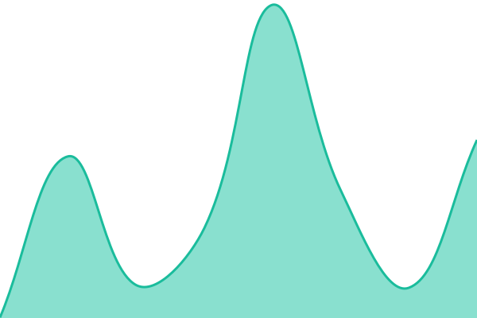

# [📈 Live Status](https://bcit-tlu.github.io/status): <!--live status--> **🟧 Partial outage**

This repository contains the open-source uptime monitor and status page for [BCIT Teaching and Learning Unit](https://course-production-site.ltc.bcit.ca), powered by [Upptime](https://github.com/upptime/upptime).

With [Upptime](https://upptime.js.org), you can get your own unlimited and free uptime monitor and status page, powered entirely by a GitHub repository. We use [Issues](https://github.com/bcit-tlu/status/issues) as incident reports, [Actions](https://github.com/bcit-tlu/status/actions) as uptime monitors, and [Pages](https://bcit-tlu.github.io/status) for the status page.

<!--start: status pages-->
<!-- This summary is generated by Upptime (https://github.com/upptime/upptime) -->
<!-- Do not edit this manually, your changes will be overwritten -->
<!-- prettier-ignore -->
| URL | Status | History | Response Time | Uptime |
| --- | ------ | ------- | ------------- | ------ |
|  [cdn: sugar-suite/2eca025](https://bcitcdn-abe4a4ath0cqfucs.z03.azurefd.net/sugar-suite/2eca025/js/lat.js) | 🟩 Up | [cdn-sugar-suite-2eca025.yml](https://github.com/bcit-tlu/status/commits/HEAD/history/cdn-sugar-suite-2eca025.yml) | 

 28ms
     
 | 

<a href="https://bcit-tlu.github.io/status/history/cdn-sugar-suite-2eca025">100.00%</a>
    

|  [Conversion Guide](https://conversion-guide.ltc.bcit.ca) | 🟩 Up | [conversion-guide.yml](https://github.com/bcit-tlu/status/commits/HEAD/history/conversion-guide.yml) | 

 365ms
     
 | 

<a href="https://bcit-tlu.github.io/status/history/conversion-guide">100.00%</a>
    

|  [CORGI](https://corgi.ltc.bcit.ca) | 🟥 Down | [corgi.yml](https://github.com/bcit-tlu/status/commits/HEAD/history/corgi.yml) | 

 538ms
     
 | 

<a href="https://bcit-tlu.github.io/status/history/corgi">96.01%</a>
    

|  [Course Workload Estimator](https://course-workload-estimator.ltc.bcit.ca) | 🟩 Up | [course-workload-estimator.yml](https://github.com/bcit-tlu/status/commits/HEAD/history/course-workload-estimator.yml) | 

 252ms
     
 | 

<a href="https://bcit-tlu.github.io/status/history/course-workload-estimator">100.00%</a>
    

|  [H5P](https://h5p.commons.bcit.ca) | 🟩 Up | [h5-p.yml](https://github.com/bcit-tlu/status/commits/HEAD/history/h5-p.yml) | 

 483ms
     
 | 

<a href="https://bcit-tlu.github.io/status/history/h5-p">77.58%</a>
    

|  [HRIV](https://hriv.ltc.bcit.ca) | 🟩 Up | [hriv.yml](https://github.com/bcit-tlu/status/commits/HEAD/history/hriv.yml) | 

 292ms
     
 | 

<a href="https://bcit-tlu.github.io/status/history/hriv">100.00%</a>
    

|  [Learning Hub](https://learn.bcit.ca/shared/header.htm) | 🟩 Up | [learning-hub.yml](https://github.com/bcit-tlu/status/commits/HEAD/history/learning-hub.yml) | 

 451ms
     
 | 

<a href="https://bcit-tlu.github.io/status/history/learning-hub">100.00%</a>
    

|  [Legacy apps](https://ltc.bcit.ca/multimedia/) | 🟩 Up | [legacy-apps.yml](https://github.com/bcit-tlu/status/commits/HEAD/history/legacy-apps.yml) | 

 205ms
     
 | 

<a href="https://bcit-tlu.github.io/status/history/legacy-apps">100.00%</a>
    

|  [Open Data](https://open-data.ltc.bcit.ca) | 🟩 Up | [open-data.yml](https://github.com/bcit-tlu/status/commits/HEAD/history/open-data.yml) | 

 302ms
     
 | 

<a href="https://bcit-tlu.github.io/status/history/open-data">100.00%</a>
    

|  [qcon](https://qcon.ltc.bcit.ca) | 🟩 Up | [qcon.yml](https://github.com/bcit-tlu/status/commits/HEAD/history/qcon.yml) | 

 248ms
     
 | 

<a href="https://bcit-tlu.github.io/status/history/qcon">100.00%</a>
    

|  [QF-PCR](https://qf-pcr.ltc.bcit.ca) | 🟩 Up | [qf-pcr.yml](https://github.com/bcit-tlu/status/commits/HEAD/history/qf-pcr.yml) | 

 214ms
     
 | 

<a href="https://bcit-tlu.github.io/status/history/qf-pcr">100.00%</a>
    

|  [Tech Ops Docs](https://tech-ops-docs.ltc.bcit.ca) | 🟩 Up | [tech-ops-docs.yml](https://github.com/bcit-tlu/status/commits/HEAD/history/tech-ops-docs.yml) | 

 287ms
     
 | 

<a href="https://bcit-tlu.github.io/status/history/tech-ops-docs">100.00%</a>
    

|  [Sugar Suite](https://sugar-suite.ltc.bcit.ca) | 🟩 Up | [sugar-suite.yml](https://github.com/bcit-tlu/status/commits/HEAD/history/sugar-suite.yml) | 

 228ms
     
 | 

<a href="https://bcit-tlu.github.io/status/history/sugar-suite">100.00%</a>
    

|  [public/v1](https://ltc.bcit.ca/public/v1/js/lat.js) | 🟩 Up | [public-v1.yml](https://github.com/bcit-tlu/status/commits/HEAD/history/public-v1.yml) | 

 162ms
     
 | 

<a href="https://bcit-tlu.github.io/status/history/public-v1">100.00%</a>
    

|  [ETS Online Help Centre](https://www.techhelpbcit.ca/) | 🟩 Up | [ets-online-help-centre.yml](https://github.com/bcit-tlu/status/commits/HEAD/history/ets-online-help-centre.yml) | 

 3062ms
     
 | 

<a href="https://bcit-tlu.github.io/status/history/ets-online-help-centre">100.00%</a>
    

|  [Monitoring (Watchdog)](https://grafana.ltc.bcit.ca/api/datasources/proxy/uid/prometheus/api/v1/query?query=ALERTS%7Balertname%3D%22Watchdog%22%2Calertstate%3D%22firing%22%7D) | 🟩 Up | [monitoring-deadman.yml](https://github.com/bcit-tlu/status/commits/HEAD/history/monitoring-deadman.yml) | 

 260ms
     
 | 

<a href="https://bcit-tlu.github.io/status/history/monitoring-deadman">100.00%</a>
    

|  [Alertmanager (stable)](https://grafana.ltc.bcit.ca/api/datasources/proxy/uid/prometheus/api/v1/query?query=up%7Bjob%3D%22kps-alertmanager%22%7D%20%3D%3D%201) | 🟩 Up | [alertmanager-stable.yml](https://github.com/bcit-tlu/status/commits/HEAD/history/alertmanager-stable.yml) | 

 159ms
     
 | 

<a href="https://bcit-tlu.github.io/status/history/alertmanager-stable">100.00%</a>
    

<!--end: status pages-->

[**Visit our status website →**](https://bcit-tlu.github.io/status)

## 📄 License

- Powered by: [Upptime](https://github.com/upptime/upptime)
- Code: [MIT](./LICENSE) © [Anand Chowdhary](https://anandchowdhary.com), supported by [Pabio](https://pabio.com)
- Data in the `./history` directory: [Open Database License](https://opendatacommons.org/licenses/odbl/1-0/)
